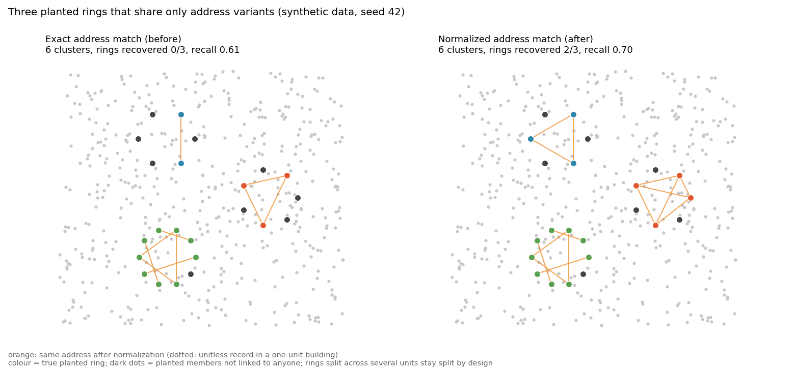

# fraud-rings

[](https://colab.research.google.com/github/RishabhPande/fraud-rings/blob/main/examples/quickstart.py)

Synthetic identity-fraud **ring generator** plus **graph-based detection**, all in pure Python, no dependencies.

Real fraud rings hide in plain sight: a dozen "different" applicants who share
two devices, recycle phone numbers, live at cosmetic variants of one address,
and use SSNs that differ by a single digit. `fraud-rings` lets you *generate*
that pattern synthetically and *detect* it with shared-attribute linking plus
union-find connected components: the workhorse technique behind production
entity-resolution pipelines.

> **Disclaimer:** every entity in this repo is synthetic. Names, SSNs, phones,
> addresses, and device IDs are randomly generated and bear no relation to real
> people. Nothing here touches real PII.

## Quickstart

```bash
python examples/quickstart.py
```

Or as a library:

```python
from fraud_rings import RingGenerator, find_rings, evaluate

entities = RingGenerator(seed=42).generate(n=500, n_rings=3)
clusters = find_rings(entities)

for c in clusters:
    print(c.size, c.evidence)   # size + shared-attribute evidence

print(evaluate(entities, clusters).summary())
```

## How detection works

1. **Link** (`fraud_rings/detection.py::link_entities`): entities get an edge
   when they share a `device_id`, `phone`, a normalized `address`, or a
   near-duplicate SSN (Hamming distance ≤ 1, found via 8-of-9 digit mask
   buckets so it stays O(n)). Address matching ignores street-type spelling
   ("Ave" = "Avenue") and treats a missing unit as a variant of the same
   address, but never links two different units in one building (see
   below).
2. **Cluster** (`find_rings`): union-find connected components over those
   edges, each returned with its shared-attribute evidence
   (`shared device x4, near-duplicate SSN x9, …`).
3. **Score** (`evaluate`): precision/recall against the planted labels, plus
   how many planted rings were recovered (≥50% of members in one cluster).

### Address normalization



Rings often reuse one address with cosmetic changes. `link_entities` compares
addresses after lowercasing, stripping punctuation and reducing street types
("Street" to "St"), then applies three rules:

| Pair | Result |
|------|--------|
| same street, same unit (or both without one) | `shared address` |
| same street, one side has no unit | `address variant` |
| same street, two different units | no link |

The last rule keeps neighbours in an apartment building apart. One caveat: an
application with no unit can bridge two different units, because components
are transitive. Pass `normalize_addresses=False` to `link_entities` or
`find_rings` for the old exact-match behaviour. Regenerate the figure with
`python examples/plot_rings.py` (needs matplotlib).

## Temporal burst detection

Real rings spray applications in a tight window before going quiet. Every
generated entity now carries an `applied_at` timestamp. Benign traffic
spread uniformly over 90 days, ring members clustered inside a 2-hour
burst. `detect_bursts()` runs a two-pointer sliding window (4h default,
≥6 applications) and merges overlapping hits.

It's a recall-oriented tripwire, not a verdict. Exactly how velocity
rules work in production: the burst routes to review, attribute linking
decides. See `examples/burst_example.py` for an adversarial ring with
fully unique attributes per member: linking finds nothing, the burst
catches all 8.

```python
from fraud_rings import RingGenerator, detect_bursts

entities = RingGenerator(seed=42).generate(n=500, n_rings=3)
for b in detect_bursts(entities):
    print(b.summary())
```

## Roadmap

- [x] Temporal burst detection (many applications in a short window)
- [ ] Louvain community detection for rings that share *weak* signals across many attributes
- [ ] GNN-based ring scorer (GraphSAGE over the entity graph)
- [ ] Larger, noisier attribute pools + adversarial ring variants that dodge naive linking

## Tests

```bash
python3 -m pytest tests/ -q
```

## Part of a fraud-ML series

- [GNN Fraud Ring Detection](https://github.com/RishabhPande/GNN-fraud-ring-detection) - GraphSAGE, GAT, GCN, GIN and LSTM from scratch in pure Python (zero dependencies) for fraud ring detection
- [Agentic Fraud Investigator](https://github.com/RishabhPande/agentic-fraud-investigator) - A multi-agent fraud investigation system in pure Python, zero dependencies.
- [ID-document-forgery-detection-CV-](https://github.com/RishabhPande/ID-document-forgery-detection-CV-) - Classic image forensics for ID-document forgery detection, written from scratch in pure Python, zero dependencies.
- [Time-series-anomaly-detection](https://github.com/RishabhPande/Time-series-anomaly-detection) - Time-series anomaly detection, including collective anomalies
- [fraud-eval](https://github.com/RishabhPande/fraud-eval) - Open benchmark for evaluating LLM-based fraud and abuse detectors (20-case smoke test, cost-aware metrics, counterfactual evaluation)
